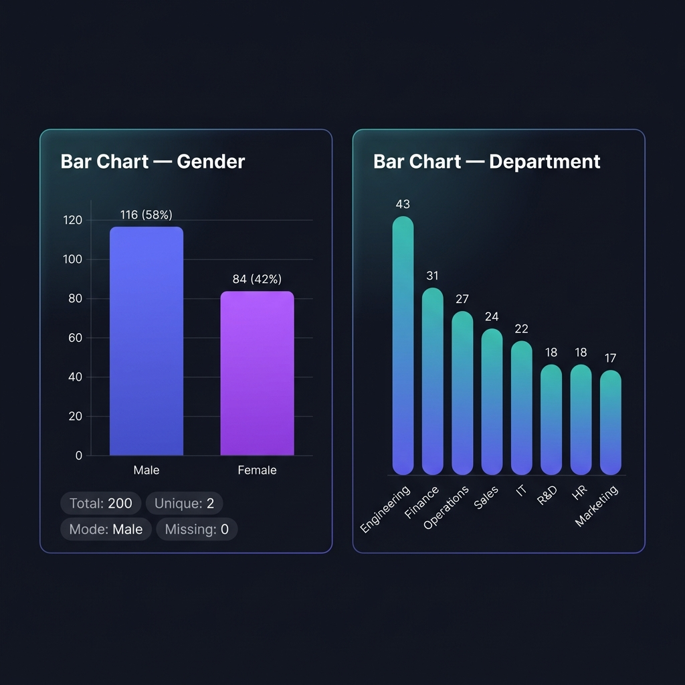
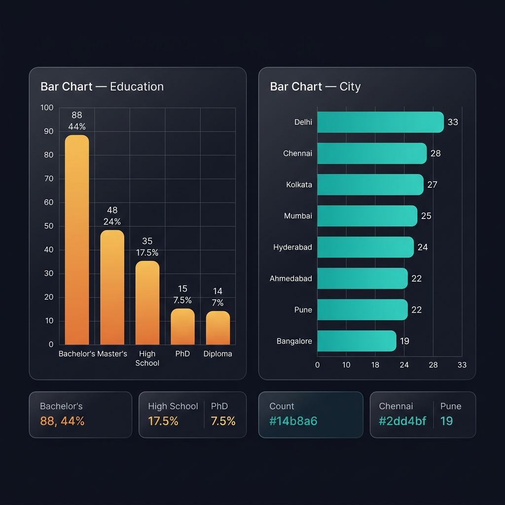
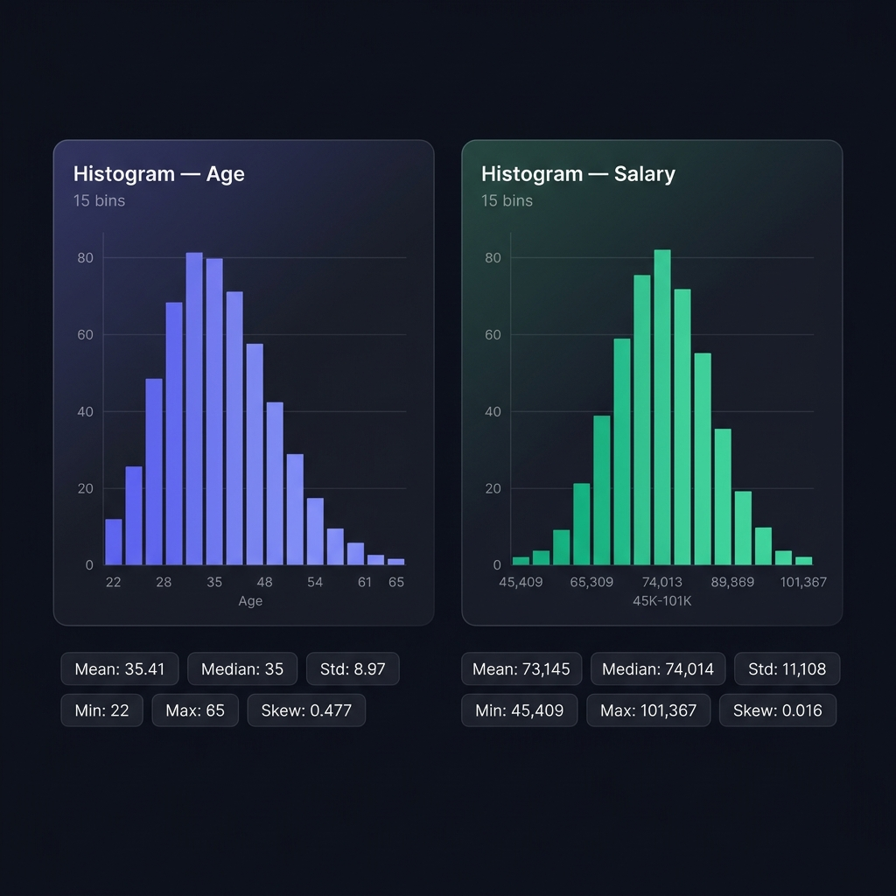
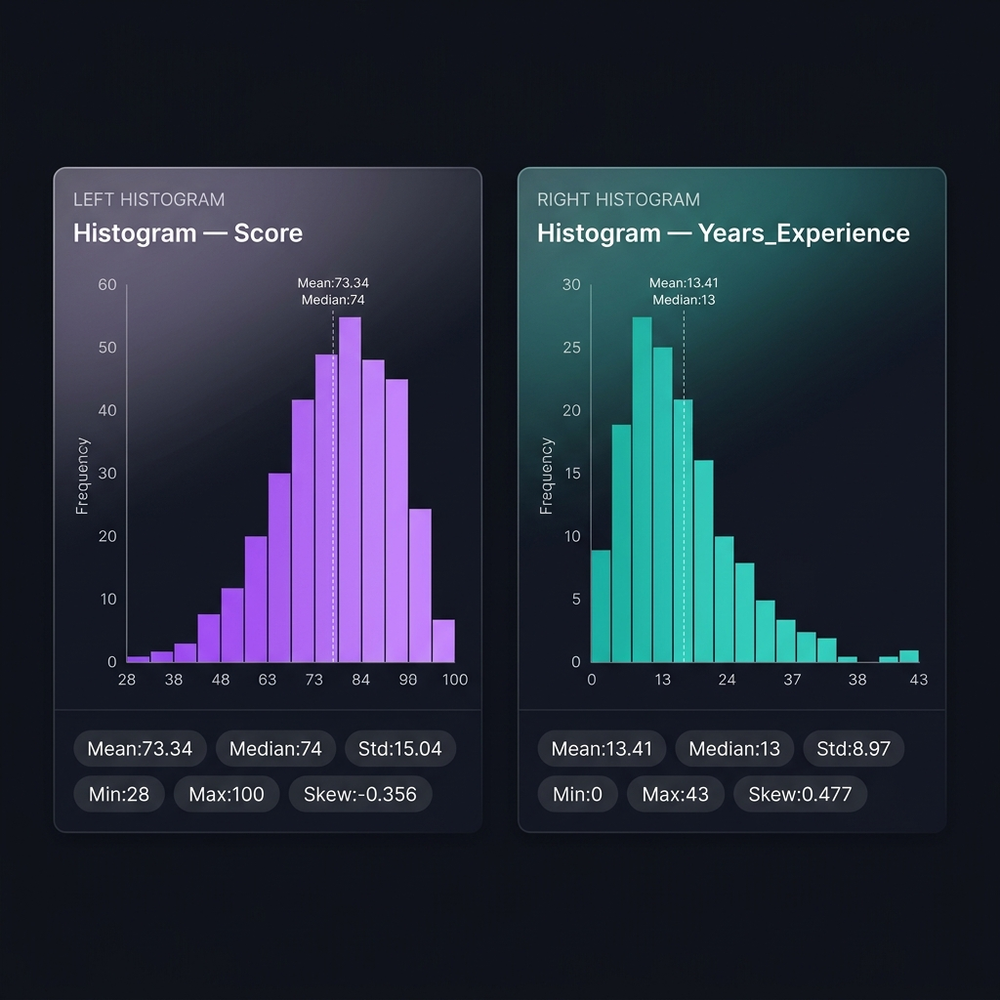

# 📊 DataViz — Interactive Data Visualization Dashboard

> **PRODIGY Full Stack Web Development Internship — Task 01**  
> An interactive Flask web dashboard for exploring data distributions using bar charts, histograms, and statistical analysis.

---

## 🚀 Live Demo Features

Built with **Flask + Chart.js**, this dashboard lets you:
- Upload **CSV / Excel** datasets or load the built-in **200-row sample dataset**
- Generate interactive **Bar Charts** for categorical columns
- Generate **Histograms** with adjustable bins for numerical columns
- Run a full **Statistical Analysis** with mean, median, mode, std, skewness
- **Export** charts as PNG and data as CSV

---

## 📸 Screenshots

### Bar Charts



### Histograms



---

## 🖼️ Sample Dataset Exploration Results

### Dataset: `sample_population_dataset.csv`
| Property | Value |
|---|---|
| Total Records | 200 |
| Total Columns | 11 |
| Numerical Columns | ID, Age, Salary, Score, Years_Experience |
| Categorical Columns | Name, Gender, Education, Department, Occupation, City |
| Missing Values | **0** (complete dataset) |

---

## 📊 Bar Charts

### 1. Gender Distribution
| Category | Count | Percentage |
|---|---|---|
| Male | 116 | 58.0% |
| Female | 84 | 42.0% |

> **Mode:** Male · **Unique:** 2 · **Missing:** 0  
> The distribution is skewed toward Male (58%), though relatively balanced.

---

### 2. Department Distribution
| Category | Count | Percentage |
|---|---|---|
| Engineering | 43 | 21.5% |
| Finance | 31 | 15.5% |
| Operations | 27 | 13.5% |
| Sales | 24 | 12.0% |
| IT | 22 | 11.0% |
| R&D | 18 | 9.0% |
| HR | 18 | 9.0% |
| Marketing | 17 | 8.5% |

> **Mode:** Engineering · **Unique:** 8 · **Missing:** 0  
> Distribution is relatively balanced. Engineering leads with 21.5%.

---

### 3. Education Distribution
| Category | Count | Percentage |
|---|---|---|
| Bachelor's | 88 | 44.0% |
| Master's | 48 | 24.0% |
| High School | 35 | 17.5% |
| PhD | 15 | 7.5% |
| Diploma | 14 | 7.0% |

> **Mode:** Bachelor's · **Unique:** 5 · **Missing:** 0  
> Bachelor's degree holders dominate at 44%. Higher education (Master's + PhD) accounts for 31.5%.

---

### 4. City Distribution
| Category | Count | Percentage |
|---|---|---|
| Delhi | 33 | 16.5% |
| Chennai | 28 | 14.0% |
| Kolkata | 27 | 13.5% |
| Mumbai | 25 | 12.5% |
| Hyderabad | 24 | 12.0% |
| Ahmedabad | 22 | 11.0% |
| Pune | 22 | 11.0% |
| Bangalore | 19 | 9.5% |

> **Mode:** Delhi · **Unique:** 8 · **Missing:** 0  
> Very evenly distributed across 8 Indian cities. Delhi leads narrowly.

---

## 📈 Histograms

### 1. Age Distribution
| Statistic | Value |
|---|---|
| Mean | 35.41 |
| Median | 35.0 |
| Mode | 22.0 |
| Std Dev | 8.97 |
| Min | 22 |
| Max | 65 |
| Q1 (25th) | 28.0 |
| Q3 (75th) | 41.0 |
| Skewness | **+0.477** (right-skewed) |
| Kurtosis | 0.024 |
| Missing | 0 |

> Distribution is approximately normal with a slight **right skew** — younger employees are slightly more common. Ages range from 22 to 65.

---

### 2. Salary Distribution
| Statistic | Value |
|---|---|
| Mean | ₹73,144.52 |
| Median | ₹74,013.50 |
| Mode | ₹58,528.00 |
| Std Dev | ₹11,108.07 |
| Min | ₹45,409 |
| Max | ₹1,01,367 |
| Q1 (25th) | ₹65,006.25 |
| Q3 (75th) | ₹80,006.75 |
| Skewness | **+0.016** (nearly symmetric) |
| Kurtosis | -0.274 |
| Missing | 0 |

> Salary is **almost perfectly normally distributed** (skewness ≈ 0). Most salaries cluster between ₹65K–₹80K. Engineering and R&D command the highest pay.

---

### 3. Score Distribution
| Statistic | Value |
|---|---|
| Mean | 73.34 |
| Median | 74.0 |
| Mode | 71.0 |
| Std Dev | 15.04 |
| Min | 28 |
| Max | 100 |
| Q1 (25th) | 64.0 |
| Q3 (75th) | 84.25 |
| Skewness | **-0.356** (slight left-skew) |
| Kurtosis | -0.027 |
| Missing | 0 |

> Scores show a slight **left skew** — most scores cluster toward higher values. The majority of employees score above 64.

---

### 4. Years_Experience Distribution
| Statistic | Value |
|---|---|
| Mean | 13.41 |
| Median | 13.0 |
| Std Dev | 8.97 |
| Min | 0 |
| Max | 43 |
| Q1 (25th) | 6.0 |
| Q3 (75th) | 19.0 |
| Skewness | **+0.477** (right-skewed) |
| Kurtosis | 0.024 |
| Missing | 0 |

> Experience is **right-skewed** — younger/newer employees are more represented. Range spans 0–43 years.

---

## 🔬 Full Data Analysis — Statistical Summary

### Numerical Variables
| Column | Mean | Median | Std Dev | Min | Max | Skewness |
|---|---|---|---|---|---|---|
| Age | 35.41 | 35.0 | 8.97 | 22 | 65 | +0.477 |
| Salary | 73,144.52 | 74,013.5 | 11,108.07 | 45,409 | 1,01,367 | +0.016 |
| Score | 73.34 | 74.0 | 15.04 | 28 | 100 | -0.356 |
| Years_Experience | 13.41 | 13.0 | 8.97 | 0 | 43 | +0.477 |

### Categorical Variables Summary
| Column | Unique | Mode | Missing |
|---|---|---|---|
| Gender | 2 | Male | 0 |
| Education | 5 | Bachelor's | 0 |
| Department | 8 | Engineering | 0 |
| Occupation | 10 | Data Analyst | 0 |
| City | 8 | Delhi | 0 |

---

## 🛠️ Tech Stack

| Layer | Technology |
|---|---|
| Backend | Python 3.14, Flask 3.1.3 |
| Data Processing | Pandas 3.1.0, NumPy 2.5.4, SciPy 1.18.1 |
| File Support | OpenPyXL 3.1.5 (Excel) |
| Frontend | HTML5, Vanilla CSS, JavaScript |
| Charts | Chart.js 4.4.4 |
| UI Framework | Bootstrap 5.3.3 |
| Icons | Bootstrap Icons 1.11.3 |
| Fonts | Google Fonts — Inter, JetBrains Mono |

---

## ⚙️ Setup & Run

```bash
# 1. Clone the repository
git clone https://github.com/shreyashree-19/PRODIGY_DS_01.git
cd PRODIGY_DS_01

# 2. Create virtual environment
uv venv .venv
# or: python -m venv .venv

# 3. Activate the virtual environment
# Windows:
.venv\Scripts\activate
# macOS/Linux:
source .venv/bin/activate

# 4. Install dependencies
pip install -r requirements.txt

# 5. Run the app
python app.py
```

Then open your browser at **http://127.0.0.1:5000**

---

## 📁 Project Structure

```
PRODIGY_DS_01/
├── app.py                  # Flask backend — all API routes
├── requirements.txt        # Python dependencies
├── templates/
│   └── index.html          # Full dashboard UI (690 lines)
├── static/
│   ├── css/
│   │   └── style.css       # Dark glassmorphism theme
│   └── js/
│       └── main.js         # Chart.js logic & interactivity
└── .gitignore
```

---

## 📌 API Endpoints

| Method | Route | Description |
|---|---|---|
| `GET` | `/` | Render dashboard UI |
| `POST` | `/api/load-sample` | Load built-in 200-row dataset |
| `POST` | `/api/upload` | Upload CSV/Excel file |
| `POST` | `/api/bar-chart` | Get bar chart data for a column |
| `POST` | `/api/histogram` | Get histogram data + stats |
| `GET` | `/api/analysis` | Full statistical summary |
| `GET` | `/api/export-csv` | Download dataset as CSV |
| `POST` | `/api/reset` | Clear all data |

---

*Made with ❤️ for Prodigy InfoTech Full Stack Web Development Internship — Task 01*
